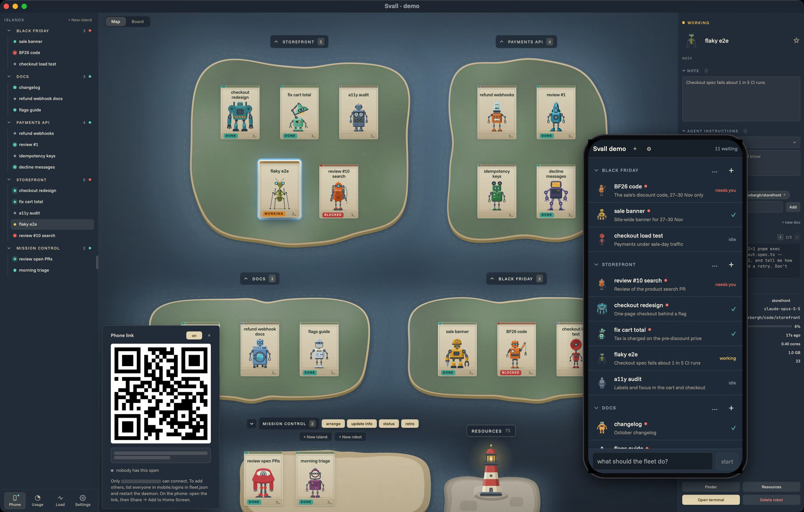
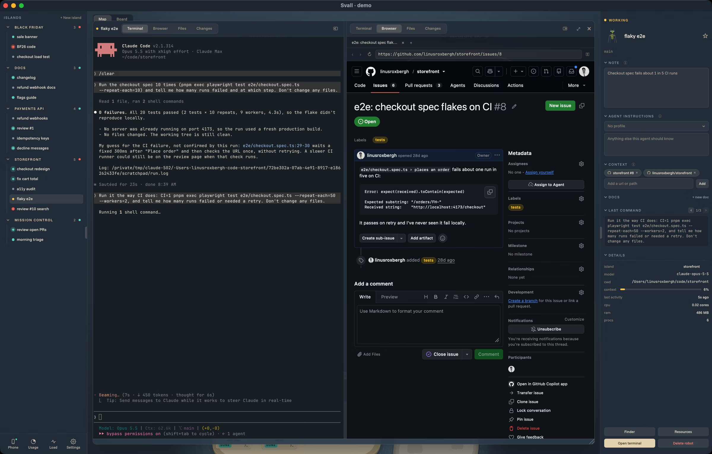

# Svall

> [!NOTE]
> **Alpha**: early and changing fast. Expect rough edges.

A macOS map of your Claude Code, Codex and OpenCode agents. Every terminal is a
robot on an island, so you can see at a glance which agents are working,
waiting on you or done.





- Islands group your robots, say one per project, on a map, and a board
  sorts them into columns by stage.
  Each card shows its agent's status, context use, model and links such as its
  PR and ticket.
- Each terminal is a tmux window. Quitting a fleet's window stops its
  terminals; opening a robot again resumes its session with
  `claude --resume`, `codex resume` or `opencode -s`.
- Give an island or robot instructions, links, files or folders, and
  agents leave notes for the next agent. Each session starts with a short brief
  of all of it, plus its repository, PR and ticket, and gets
  a diff when any of it changes. The brief also tells the agent when to hand
  work to a new robot.
- Resources lists the instructions, skills, subagents, commands, MCP servers,
  plugins, hooks and settings that Claude Code and Codex give your agents, and
  opens each in an editor.
- Every terminal has a browser, a file editor and the working tree's changes
  beside it.
- The scribe names each robot and keeps its note up to date.
- Mission control's buttons start a helper agent that updates or reports on
  the fleet.
- A macOS banner tells you when an agent is blocked or done. A blocked one has
  Approve and Deny on it.
- Your phone gets the fleet and any terminal over Tailscale, with push
  notifications.
- The `svall` CLI scripts the fleet: make robots, send prompts, wait for
  them.

## Quickstart

You need an Apple Silicon Mac on macOS 15 or newer, and the Claude Code CLI,
the Codex CLI or OpenCode. The Claude and Codex desktop apps don't install the
CLIs.

1. Install the [Claude Code CLI](https://code.claude.com/docs/en/setup), which
   works with a Claude subscription or an Anthropic API key, or the
   [Codex CLI](https://learn.chatgpt.com/docs/codex/cli) 0.156 or newer, which
   works with an OpenAI API key alone, or [OpenCode](https://opencode.ai/v2/docs/)
   2.0.22 or newer, which runs on OpenCode Zen's free models without an account
   or on any provider you sign in to. See [Using API keys](#using-api-keys).

2. Download Svall from [svall.dev](https://svall.dev) and drag `Svall.app` to
   Applications, or run:

       curl -fsSL https://svall.dev/install.sh | sh

   The script installs to `/Applications`, or `~/Applications` when that isn't
   writable, or `$SVALL_INSTALL_DIR`. It checks the download's checksum,
   developer signature and Apple notarization, then opens the app.

3. Open Svall. The setup screen lists the agents it found and asks for your
   projects folder. **Review changes** lists the files it will write. If it
   finds none of the three CLIs, it shows how to install one and checks again
   when you return. Its hooks do nothing outside Svall;
   [What setup changes](#what-setup-changes) has the details. If
   `~/.local/bin` isn't on your PATH, it shows the line to add to your shell
   profile so the `svall` command works.

4. A new fleet opens with Island 1 holding one robot, a shell in your
   projects folder, and a short tour of the map. The shell becomes an agent
   when you type `claude`, `codex` or `opencode`. `+ New island` on the sandbar
   at the bottom makes another island, and Cmd+T another robot. With more
   than one CLI installed, the app asks which one the scribe and mission
   control run. Change it later in Settings or with `svall agent codex`.

## Using Svall

### Using API keys

Svall has no AI account or billing of its own. The provider whose key you use
bills the calls.

For Claude Code, put an
[Anthropic API key](https://console.anthropic.com/settings/keys) in the private
fleet's `.env` (another fleet's is `~/.svall-<fleet>/.env`):

    mkdir -p ~/.svall
    touch ~/.svall/.env
    chmod 600 ~/.svall/.env
    nano ~/.svall/.env

Add `ANTHROPIC_API_KEY=your-key` on its own line, and keep the key out of this
repository and your shell history. New robot shells and the Claude scribe
read it, and it signs Claude Code in; `svall doctor` shows whether it did. A
shell that is already running keeps its old environment, so after changing the
file, create a new robot or revive a dormant one. Claude Code may ask once
before it uses the key; see its
[environment variable reference](https://code.claude.com/docs/en/env-vars).

For Codex, sign the CLI in with an
[OpenAI API key](https://platform.openai.com/api-keys) before you start a Codex
robot. With `OPENAI_API_KEY` set in your normal terminal, run:

    printenv OPENAI_API_KEY | codex login --with-api-key
    codex login status

An `OPENAI_API_KEY` in the fleet's `.env` reaches new robot shells, but
Codex doesn't log in from it. See the
[Codex authentication guide](https://learn.chatgpt.com/docs/auth).

For OpenCode, sign in to a provider with `opencode auth login`. An
`ANTHROPIC_API_KEY` or `OPENAI_API_KEY` in the fleet's `.env` also reaches new
robot shells, but not the OpenCode scribe.

The scribe and mission control run the main agent's CLI, so a Codex-only
install needs no Claude login. The Usage panel shows Claude and Codex plan
limits, not API spending.

### Codex and OpenCode

A Codex or OpenCode robot gets the same status, context gauge, revive, brief
and scribe as a Claude Code one. Codex runs only hooks you trust: choose "Trust
all and continue" on its startup dialog, or trust the hook later with `/hooks`,
and do so again whenever it changes. Until then the robot stays a plain shell
with a warning. [docs/agents.md](docs/agents.md) covers what Svall changes in
how each agent runs.

### Updating

Svall checks for updates on its own. When one is out, the private fleet's window
shows a blue dot on the sidebar's Settings button, and Settings ends with an
Update button. In that window, Svall → Check for Updates… checks now. Installing
quits every Svall window, which stops each fleet; a robot picks up where it
left off when you open it.

### Uninstalling

Svall → Uninstall Svall… stops every fleet and its tmux server, removes the
hooks (your own statusline stays), the launchd agents, the `svall` command and
each fleet's phone link, and moves the app to the Trash. The settings backups
stay. With "Also delete fleet data" ticked, it deletes `~/.svall`, the other
fleets' homes and the app's preferences, sign-ins and caches in `~/Library` too.

`svall uninstall` does the same from a terminal, but deletes the app instead of
moving it to the Trash, and asks before deleting it or the fleets. `--purge`
deletes them without asking.

With [remote machines](docs/remote-machines/README.md), move each robot back
to this Mac and remove each machine with `svall host remove <name>` first:
`svall uninstall` on the Mac leaves Svall running on them.

### When something breaks

Choose Help, Send Feedback… in the app, describe what happened and send it.
The report can carry diagnostics, which See what's sent shows before you send.

`svall doctor` checks what the fleet needs and prints the end of the daemon's
log, `~/.svall/svalld.log`. It names your home and paths, so read it before
pasting it into an issue on
[linusroxbergh/svall](https://github.com/linusroxbergh/svall/issues).

If a new robot's terminal takes seconds to show its prompt, zsh is usually
rebuilding its completion cache. Homebrew's `brew shellenv` exports `FPATH`, so
shells that Claude Code starts rewrite `~/.zcompdump`. Add this line to the end
of `~/.zshrc`:

```zsh
typeset +x FPATH
```

### Migrating from Herdr

Ask your agent to move your Herdr workspaces into Svall.
`~/.config/herdr/session.json`, or `sessions/<name>/session.json` there for a
named session, lists each workspace with its folder, and each agent pane with
its folder and session id. Each workspace becomes an island, and each agent pane
a robot that resumes its conversation:

```sh
svall island create "<workspace>"
svall robot new --island <id> --cwd <folder> --command "claude --resume <session id>"
```

Close the panes in Herdr first, so one session doesn't run in both.

## Build from source (Svall Dev)

A checkout builds `Svall Dev.app`, which runs beside the release without
touching its fleets. [`CONTRIBUTING.md`](CONTRIBUTING.md#build-from-source-svall-dev)
has the steps.

## Concepts

- **Fleet**: one daemon, one tmux server, one window. `svall` opens the
  private fleet, and `svall work` opens a separate fleet named `work`, offering
  to create it the first time. In the app, the File menu lists this Mac's
  fleets and makes new ones, Cmd+Shift+O picks one from the keyboard, and
  Settings renames a fleet.
- **Island**: a group of robots. Mission control is the fixed one at the
  bottom.
- **Robot**: one terminal. Type `claude`, `codex` or `opencode` in it and
  the map tracks the agent: `working`, `idle`, `blocked` (waiting on you) or
  `done`. An agent idle or done for 12 hours is closed to free its memory and
  resumes when you open its terminal; Settings → close idle agents after
  changes the wait or turns it off.
- **Scribe**: about a minute after an agent stops with new work, and every ten
  minutes or so while it keeps working, a headless `claude -p`, `codex exec`
  or `opencode run` writes the robot's name, note and links, and the
  island's description. Notes you wrote stay, and a name you gave only gains a PR or
  ticket id. Passes start at most once a minute, so a busy fleet can run 60 an
  hour, and each costs money on an API key. A new fleet asks before turning the
  scribe on, and you can turn it off in Settings. With board placing on, the
  same pass also moves the robot to the board column that fits, unless you
  placed it by hand.

## The desktop app

- **Map**: double-click a card to open its terminal; Cmd+Enter switches
  between half and full size. Drag cards between islands, onto another card to
  swap them, or onto water to make a new island. Drag an island's label to move
  it and its corner to resize it. On mission control, `arrange` packs the fleet
  into the window, and `update info`, `status` and `retro` start a helper agent.
  A retro reads what your agents did over a span and proposes changes to your
  skills, reviews and instructions; it shows its cost and asks before it runs.
- **Board** (Cmd+M, or the Map/Board switch at the top left): every robot as a
  card in a column: To do, In progress, In review and Done until you rename,
  reorder, add or delete them. Drag a card, or right-click → Move to, to place
  it; its agent is told nothing. A card names its island, and the bar filters
  by island and by robots that need you; its Auto-place chip says whether the
  scribe places robots, and its Place now has the scribe place them at once,
  dormant robots from the transcripts they left.
- **Sidebar**: islands as a folder tree. Drag robots and islands to move or
  reorder them. A starred robot also stands in Starred at the top, newest
  first; drag there to star one at a spot or to reorder.
- **Side card** (Cmd+I): the robot's note, agent profile, instructions,
  context, docs, last prompts, model, directory and context use.
- **Browser** (Cmd+2): tabs survive a relaunch, and the agent sees their
  addresses. Sign in once per fleet by importing Chrome's cookies, or fill
  logins from 1Password with the key button by the address bar once you turn it
  on in Settings and install the 1Password CLI.
- **Files** (Cmd+3): an editor for the robot's directory. A file the agent
  rewrites reloads unless you have changed it.
- **Changes** (Cmd+4): each file's diff against HEAD, or against the point
  where the branch left main.
- **Resources** (Cmd+Shift+R, or the lighthouse islet): what `~/.claude`,
  `~/.codex`, the fleet's docs and each repository give your agents.
  `~/.claude.json` and `~/.codex/auth.json` hold tokens and never open.
- **Settings** (Cmd+,): this machine, browser, keyboard, notifications, phone,
  and the fleet's name, main agent, scribe, their models and idle timeout. `Usage`, next to
  it, shows the plan limits of your running agents without using any, and the
  login they belong to.

### Keyboard

Terminals are Ghostty surfaces and read your Ghostty config. The app takes the
chords below and passes everything else to the terminal. Rebind or clear any of
them under *Keyboard* in Settings. A chord your Ghostty config binds when
Svall first launches stays with Ghostty until you claim it there.

| Keys | Action | Keys | Action |
| --- | --- | --- | --- |
| Cmd+T | New robot | Cmd+W | Close the card or robot |
| Cmd+J | Next robot | Cmd+K | Previous robot |
| Cmd+Shift+J | Next island | Cmd+M | Map or board |
| Cmd+I | Side card | Cmd+Enter | Card size |
| Cmd+1 to 4 | Terminal, browser, files, changes | Cmd+B | Browser beside the terminal |
| Cmd+L | Address bar | Cmd+G | Prompt mission control |
| Cmd+Shift+R | Resources | Cmd+Shift+P | Every command, by name |
| Cmd+, | Settings | Cmd+- / = / 0 | Zoom |
| Cmd+Shift+A | Arrange the fleet | Cmd+U | First link beside the terminal |
| Cmd+Shift+O | Open a fleet | Cmd+Q | Quit |
| Cmd+Shift+S | Sidebar and side card | | |

Clicking a link asks whether to open it in the robot's browser or
yours, and selecting text copies it. With Shift held, a selection or middle-click
goes to Ghostty instead of tmux: the selection copies and the middle-click pastes,
unless your Ghostty config's `copy-on-select` or `middle-click-action` says
otherwise. A robot on a worker copies through OSC 52,
which your Ghostty config's `clipboard-write` governs: `ask` asks at every copy,
and `deny` drops it. Terminals attach to tmux, so Ghostty's `initial-command`
and `input` are ignored.

## The `svall` CLI

    svall status                                  # every island and robot
    svall island create feature
    svall robot new --island feature --cwd ~/repo --claude
    svall robot run <id> "review the failing tests in src/api"
    svall robot wait <id> --until done,blocked     # exits 0 on a match, 2 on timeout, 3 when it has no terminal
    svall robot read <id> --transcript --lines 20
    svall robot read <id> --last                   # its agent's final answer, in full
    svall robot send <id> "<text>"                 # from inside a robot: a message it can answer
    svall robot revive <id>                        # a dormant robot, resumed
    svall robot show <id>                          # the brief its agent gets

- A name works wherever an id does. `--json` prints machine-readable output,
  `-p <fleet>` targets another fleet, and `--term 2` a split robot's second
  terminal.
- `island create`, `island update` and `robot update` take `--instructions`,
  for the agent only, such as "merge without asking", and
  `--context "<url or ~/path>[ label]"`, which sets the links, files or folders
  it gets; `--pin <ref>` marks one to read first.
- `--agent-profile <name>` gives a robot's agent a role from the fleet's
  `agent-profiles` folder. Six ship with a new fleet (architect, debugger,
  explorer, planner, reviewer, verifier); edit them or add your own in
  Resources.
- `svall <command> --help` lists the rest.

## Phone

    svall mobile          # serve over Tailscale and print a QR (also a switch in settings)
    svall mobile off

- Open the link on your phone, then choose Share → Add to Home Screen. You get
  every island and robot as a list, the starred ones also first, and a
  robot's terminal full screen with Esc, Tab, Shift-Tab, Ctrl-C, arrows and
  Return above the keyboard; `⋯` lists the agent's other keys and slash
  commands. A prompt typed under the list starts a mission control robot on
  it, as Cmd+G does on the Mac, and the island's `…` has its buttons.
- `⚙` → *Notify this phone* sends a push when an agent is blocked or done. Tap
  a blocked one to approve or deny it.
- The page and its pushes work while Svall is open on that fleet, since its
  daemon serves them.
- The tailnet needs MagicDNS and HTTPS certificates turned on in Tailscale's
  admin console. The certificate puts the Mac's tailnet name in a public log.
- Only your own tailnet login gets in, on a phone that opened the QR code's
  link or the copied one; no token reaches the phone. To let others in, list
  their logins and yours in `mobile.logins` and restart the daemon. To unpair
  every phone, delete `mobile-pass` in the fleet's folder and restart it; a
  Home Screen app is then removed and added again from the QR code's link.
- Each fleet is its own Home Screen app, on its own port;
  [`mobile.httpsPort`](docs/configuration.md) says which.

## Remote machines

A robot can also run on an always-on Linux machine, a worker of your fleet,
and keep working there while the Mac sleeps: **Move to** the machine on its
card, or `svall robot move <id> --machine <name>`, carries its conversation,
branch, commits and uncommitted changes there and back.
[docs/remote-machines](docs/remote-machines/README.md) covers the machine it
needs (Ubuntu, at any account you reach with ssh), adding it with
`svall host add`, and moving robots.

## Configuration

A fleet keeps everything in its home: `~/.svall` for the private fleet
and `~/.svall-<name>` for the others, unless `SVALL_HOME` says otherwise.
[docs/configuration.md](docs/configuration.md) lists the keys of its
`fleet.json` and `node.json`, and what mission control's folder keeps.

## What setup changes

The setup screen runs `svall setup`, which also works without the app
(`--check` only checks). It changes nothing while something it needs is
missing. For each agent you leave on, it writes the files below, and for each
one you turn off it takes them out:

- `~/.claude/settings.json` (or `$CLAUDE_CONFIG_DIR/settings.json`, on Linux
  the one your login shell sets): a hook on Claude Code's session, prompt,
  tool, permission, notification, subagent and stop events, which exits before
  starting Node outside a robot, and a statusline wrapper that keeps your
  own statusline running inside it.
- `~/.codex/hooks.json` (or `$CODEX_HOME/hooks.json`): the same hook.
- `~/.config/opencode/plugins/svall.js` (or under `$XDG_CONFIG_HOME`): Svall's
  OpenCode plugin.

A change to the Claude Code or Codex file keeps a `.bak-<time>` copy, the
newest three per file. Setup and uninstall rewrite the file only when its
settings change, keeping its key order, indent, line endings and final
newline, and a file of plain ASCII in plain ASCII; in a file of several
lines, an array or object written on one line comes back spread over several. Each start of the app puts back
hooks that are missing or out of date, so to keep an agent's hooks out, leave
it off on the setup screen or run `svall setup --agents <list>`. Setup also
writes:

- `~/Library/LaunchAgents/io.github.linusroxbergh.svall.svalld*.plist`, one per
  fleet, which the app uses to start each daemon.
- `~/.local/bin/svall`: a shim into `Svall.app`.
- `~/.svall` and `~/.svall-<name>`: each fleet's state, config, log, hook
  scripts and tmux server; mission control's folder is `~/.svall/home` unless
  `home.cwd` names another, and a new profile fleet's is `~/.svall-<name>/home`.

Svall Dev writes the same under `.svall-dev`, `svall-dev` and
`io.github.linusroxbergh.svall.dev.svalld*`, and neither variant's hook acts on
the other's fleets.

## What leaves your Mac

Svall has no telemetry, analytics or crash reporting. Besides what your agents
send:

- The scribe sends the end of each agent's transcript to Claude, Codex or
  OpenCode's provider on your login or API key, with the names, notes, links,
  directories and branches of its island's robots, and the names of the
  fleet's other robots.
- Mission control's buttons start the main agent, and the Usage panel asks
  Claude Code for your plan's limits. The Claude scribe and the Usage panel get
  every value in the fleet's `.env`.
- A retro sends compacted excerpts of your agents' sessions in its span, with
  the tokens it recognizes masked, and the comments on their PRs, which it
  reads with `gh`, to the main agent's provider.
- For each robot in a repository, the daemon runs `gh pr view` to find its
  branch's PR.
- `svall mobile` serves the fleet to your tailnet with `tailscale serve`. The
  key the proxy reaches the daemon by is on that command's line, where other
  users on the Mac can read it in `ps` while it runs, and in the serve config.
  It opens nothing by itself: a phone also has to hold the pass from the QR
  code, which stays in a cookie on the phone.
- A robot's browser starts on google.com, and `svall doctor` runs
  `gh auth status`.
- A report sent from Send Feedback goes to svall.dev, which sees your IP
  address, and is filed in a private repository only the maintainer reads.
  Diagnostics are optional, and See what's sent shows them before you send:
  versions, your agents and the end of the daemon's log, which can name your
  robots, islands and repos, with your home written as `~`.
- Svall checks `https://svall.dev/appcast.xml` for updates, which tells
  svall.dev your IP address and the version you run, and downloads an update
  from its GitHub release. Svall Dev doesn't.
- A move copies a robot's agent session, branch and changes, and your agent
  configuration with only the keys you tick, over ssh to the Linux machine you
  added.
- Push notifications go through your phone's push service: Apple's, Google's
  or Mozilla's. The robot's name and prompt are encrypted for your phone;
  the service sees when a push is sent, and the page's address unless
  `mobile.pushContact` names another contact.

Importing Chrome's cookies sends nothing, but it signs the fleet's browser in
to every site the Chrome profile is signed in to.

## Contributing

[`CONTRIBUTING.md`](CONTRIBUTING.md) covers building from source, the tests
and how Svall works. There is no CLA.

## License

GPL-3.0-or-later, see [`LICENSE`](LICENSE). The name and icon are not covered by
the licence, see [`TRADEMARK.md`](TRADEMARK.md).
